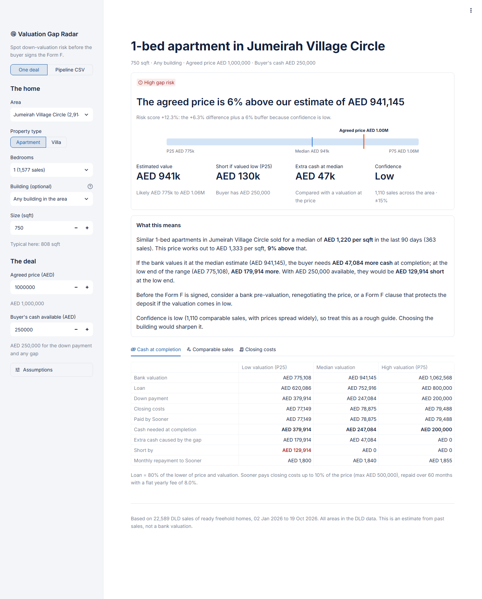
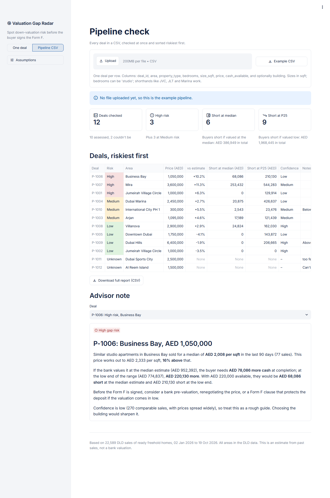

# Valuation Gap Radar

Before a first-time buyer signs, estimate the bank's likely valuation from real
Dubai Land Department (DLD) sales, score the risk that it comes in below the
agreed price, and show how much extra cash the buyer would need if it does.

Built as a demo of how [Sooner](https://www.joinsooner.com) could screen deals
for down-valuation risk.

**Live demo: [valuation-gap-radar.streamlit.app](https://valuation-gap-radar.streamlit.app)**
(or jump straight to the [pipeline report](https://valuation-gap-radar.streamlit.app/?mode=pipeline)).
The app sleeps when unused, so the first visit can take about 30 seconds.



## The problem

UAE banks lend on the **lower** of the agreed price and the bank's own
valuation. If the valuation comes in below the price, the loan shrinks and the
buyer has to make up the difference in cash: at 80% LTV, every AED 100,000 of
gap costs the buyer AED 80,000 more at completion.

Sooner covers a first-time buyer's closing costs (DLD fee, agency, mortgage
setup) up to 10% of the home's value. Those costs come to 7–9% of the price, so
Sooner covers them in full. A gap therefore lands on the **down payment**,
which is exactly where Sooner's customers have no spare cash. If they can't
find it, the deal fails, and under the Form F they can lose their deposit.

The fix is to check before the Form F is signed: is this price high compared
with what similar homes actually sold for, and if the bank agrees, how much
cash is at stake?

## What it does

**One deal.** Enter the area, property type, bedrooms, building (optional),
size, agreed price and the cash the buyer has. The app shows:

- a **risk level** (Low, Medium or High) with a plain-English advisor note,
  for example: *"Similar 1-bed apartments in Jumeirah Village Circle sold for a
  median of AED 1,220 per sqft in the last 90 days (363 sales). This price
  works out to AED 1,333 per sqft, 9% above that."*
- the **estimated value**, its likely range, confidence, and where the
  comparable sales came from
- a **cash table** for a low (P25), median and high (P75) valuation: loan,
  down payment, closing costs, what Sooner pays, cash needed, extra cash caused
  by the gap, shortfall against the buyer's cash, and the monthly Sooner
  repayment
- a **chart** of the comparable sales in AED per sqft, plus the full list

Naming the building makes a big difference. The JVC deal above is High risk
with Low confidence on area-wide sales (1,110 of them, spread ±15%). The same
deal in Binghatti Amber is Low risk with High confidence: 29 sales within ±5%.

**A pipeline.** Upload a CSV of deals (or open `?mode=pipeline` to see the
example) and get every deal checked at once, riskiest first, with a
downloadable report.



In the example pipeline, 9 of the 10 assessable buyers would be short of cash
if the bank valued at P25, including some Low-risk deals. Buyers who hold only
the 20% down payment have no buffer for even a small gap.

## How it works

### 1. Data

Source: [DLD open data](https://dubailand.gov.ae/en/open-data/real-estate-data/),
Transactions tab, filtered to Sales, Ready, Freehold, Residential. The export
holds 37,205 sales from 2 Jan to 19 Oct 2026. The ETL (`radar/etl.py`) keeps
**22,589** of them after removing:

| Removed | Rows | Why |
|---|---:|---|
| Duplicate transactions | 23 | Same transaction listed twice |
| Not a plain resale | 8,527 | "Delayed Sell" rows (off-plan contracts registered at handover) sell about 10% above resales of the same homes and would inflate the estimate; lease-to-own and developer transfers aren't market sales |
| Not an apartment or villa | 5,024 | Offices, shops, hotel rooms, land plots |
| Sale of a share of a unit | 439 | The price covers only part of the home |
| No bedroom count | 25 | Penthouses and blanks can't be matched |
| Price per sqm outside AED 5,000–150,000 | 578 | Typos and nominal transfers |

Area names are tidied (`JUMEIRAH VILLAGE CIRCLE` → `Jumeirah Village Circle`)
and a few DLD aliases are merged, each checked against the buildings listed
under it (for example `Burj Khalifa` → `Downtown Dubai`).

### 2. The estimate (`radar/comps.py`)

1. **Comparable sales:** same area, property type and bedrooms, with a size
   within 20%. If the building has at least 5 such sales, only those are used.
2. **Recency:** a sale 4 months old counts half as much as one from this week.
3. **Value range:** the weighted P25, median and P75 of price per sqm, times
   the home's size.
4. **Confidence:** High needs 10+ comps with a spread ((P75 − P25) / median) of
   15% or less; Medium needs 5+ comps with a spread of 30% or less; anything
   else is Low. Fewer than 3 comps means no estimate.
5. **Gap risk score:** how far the price sits above the median estimate, plus a
   buffer of 3 points (Medium confidence) or 6 points (Low). Under 3% is Low
   risk, 3–10% Medium, 10% or more High.

### 3. How accurate is it?

`python -m radar.backtest` estimates each sale from the last 60 days using only
the sales before it, then compares the estimate with the price actually paid:

| Confidence | Share of sales | Median error | Within ±10% | Inside P25–P75 |
|---|---:|---:|---:|---:|
| High | 32% | 5.8% | 74% | 43% |
| Medium | 43% | 7.8% | 59% | 50% |
| Low | 22% | 17.3% | 33% | 53% |
| No estimate | 3% | – | – | – |

Accuracy improves with confidence, and about half of real prices land inside
the P25–P75 range, as an interquartile range should. Same-building comps are
about twice as accurate as area-wide ones (5.8% vs 11.0% median error).

### 4. The cash (`radar/cash.py`)

For a valuation at P25, the median and P75:

- **Loan** = LTV × min(price, valuation)
- **Closing costs** = the fee lines from Sooner's site, with VAT where it applies
- **Sooner support** = min(closing costs, 10% of property value, AED 500,000)
- **Cash needed at completion** = (price − loan) + closing costs Sooner doesn't cover
- **Extra cash from the gap** = cash needed − cash needed if the bank valued at the price
- **Monthly repayment** = Sooner amount × (1 + yearly fee × 5) ÷ 60. This
  reproduces Sooner's published example (AED 161,490 at 7% ≈ AED 3,634 a month).

The deal in the screenshot: a AED 1,000,000 one-bed (750 sqft) in JVC, with
AED 250,000 of cash.

| Bank values it at | Cash needed | Extra from the gap | Short by |
|---|---:|---:|---:|
| P75: AED 1,062,568 | 200,000 | 0 | 0 |
| Median: AED 941,145 | 247,084 | 47,084 | 0 |
| P25: AED 775,108 | 379,914 | 179,914 | 129,914 |

## Assumptions

Every number lives in [`radar/config.py`](radar/config.py); change it there and
the whole app follows. LTV, Sooner's fee and the value basis can also be
changed in the app's Settings.

| Assumption | Value |
|---|---|
| Eligible homes | Ready freehold, AED 500,000 to 4,500,000 |
| Sooner covers | Closing costs up to 10% of property value, max AED 500,000 |
| Sooner repayment | 60 months, 7–9% flat yearly fee (8% default) |
| "Property value" for the 10% limit | Agreed price (switchable to valuation) |
| Loan-to-value | 80% (expat, first home under AED 5M) |
| DLD transfer fee | 4% of price + AED 580 admin |
| Agency commission | 2% of price + VAT |
| Bank arrangement fee | 1% of loan + VAT |
| Bank valuation fee | AED 3,150 + VAT |
| Mortgage registration | 0.25% of loan |
| Notary | AED 4,000 + VAT |
| VAT | 5%, not on DLD fees or mortgage registration (per Sooner's site) |
| Comparable sales | Same area, type, bedrooms; size ±20%; same building if 5+ sales |
| Recency weight | Halves every 120 days |
| Data window | Last 24 months of sales (currently Jan–Oct 2026) |

**Open questions for Sooner:**

1. Is the 10% limit based on the agreed price or the bank valuation? It only
   changes the result after a deep down-valuation: about 14% below price on a
   AED 500k home, 23% at AED 1M and 30% at AED 4.5M.
2. The fee lines above total about AED 150,900 on a AED 2M home, but Sooner's
   FAQ quotes AED 161,490 for the same home. Which costs are missing?
3. Are the bank arrangement and mortgage registration fees charged on the loan
   (assumed here, as is usual in the UAE) or on the price?

## Limitations

- **This is an estimate, not a bank valuation.** A valuer inspects the home:
  floor, view, layout, condition and upgrades all move the number, and the DLD
  data has none of them.
- **It is checked against sale prices, not valuations.** DLD doesn't publish
  bank valuations, and banks can be more conservative than the market. The risk
  thresholds are reasoned from cash impact and the backtest, not from real
  down-valuation outcomes.
- **About 9.5 months of data.** DLD's site only offers the current year; older
  years (on data.dubai) would fill the 24-month window with no code changes.
- **Thin segments.** Rare homes, such as large apartments or villas in small
  communities, get Low confidence or no estimate.
- **Names.** Buildings are DLD project names, and 24% of sales have none. Some
  DLD area names differ from the names agents use (for example `Al Yelayiss 2`);
  only a few are merged or have shorthands.
- **Simplified cash.** One LTV for everyone (non-residents and second homes get
  less). No Sooner credit checks. Ongoing costs such as interest and service
  charges are not included.

## Next steps

- **Calibrate on real outcomes.** With Sooner's history of agreed prices and
  bank valuations, the risk thresholds could be fitted to actual down-valuations
  rather than reasoned.
- **Add unit details.** Floor, view and condition from listings would tighten
  the estimate within a building.
- **Run it on the live pipeline.** Check every deal automatically when it
  enters the CRM, and alert when the risk changes.

## Run it locally

```powershell
python -m venv .venv
.venv\Scripts\Activate.ps1          # macOS/Linux: source .venv/bin/activate
pip install -r requirements-dev.txt
streamlit run app.py                # opens http://localhost:8501
```

The app runs out of the box on the committed clean data
(`data/processed/sales.parquet`, all 115 areas, under 500 KB). To refresh it,
download a newer DLD Transactions CSV (filters above) into `data/raw/`, then:

```powershell
python -m radar.etl        # rewrites data/processed/sales.parquet and the sample
python -m radar.backtest   # optional: re-check accuracy (about 30 seconds)
```

Commit the new `sales.parquet` and the deployed app picks it up.

Run the 48 unit tests with `pytest`. They cover the fee and cash maths (with
hand-worked figures), comp selection and weighting, the ETL rules, the advisor
note and batch mode.

## Deploy

The live demo runs on [Streamlit Community Cloud](https://share.streamlit.io)
(free) and redeploys automatically on every push to `main`. To deploy your own
copy:

1. Push this repository to GitHub. Streamlit lists public repos straight away;
   a private repo needs Streamlit to be granted private-repo access.
2. On share.streamlit.io, choose **Create app** → **Deploy a public app from
   GitHub**, then pick the repository, branch `main` and main file `app.py`.
3. Under **Advanced settings**, choose Python 3.11 or newer (pandas 3 needs at
   least 3.11) and leave Secrets empty, then **Deploy**.

It installs `requirements.txt` and runs on the committed data, covering every
area. To share the pipeline view directly, add `?mode=pipeline` to the app's
URL.

## Project layout

```
app.py              the Streamlit app: inputs and display only, no maths
radar/              core logic, plain Python with no UI code, so it is easy to test
  config.py         every assumption: fees, Sooner terms, thresholds, paths
  etl.py            raw DLD CSV -> clean sales table
  comps.py          comparable sales -> value range, confidence, gap risk
  backtest.py       checks the estimates against real sale prices
  cash.py           loan, closing costs, Sooner support, cash needed per scenario
  advisor.py        the plain-English advisor note
  batch.py          pipeline CSV -> one report row per deal, riskiest first
tests/              unit tests (pytest)
data/raw/           the DLD download (gitignored)
data/processed/     clean sales for all areas, the app's main data (committed)
data/sample/        smaller fallback sample and the example pipeline
docs/screenshots/   images used in this README
.streamlit/         app config (hides the developer menu from viewers)
```
